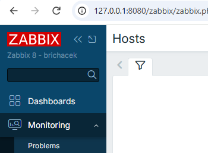
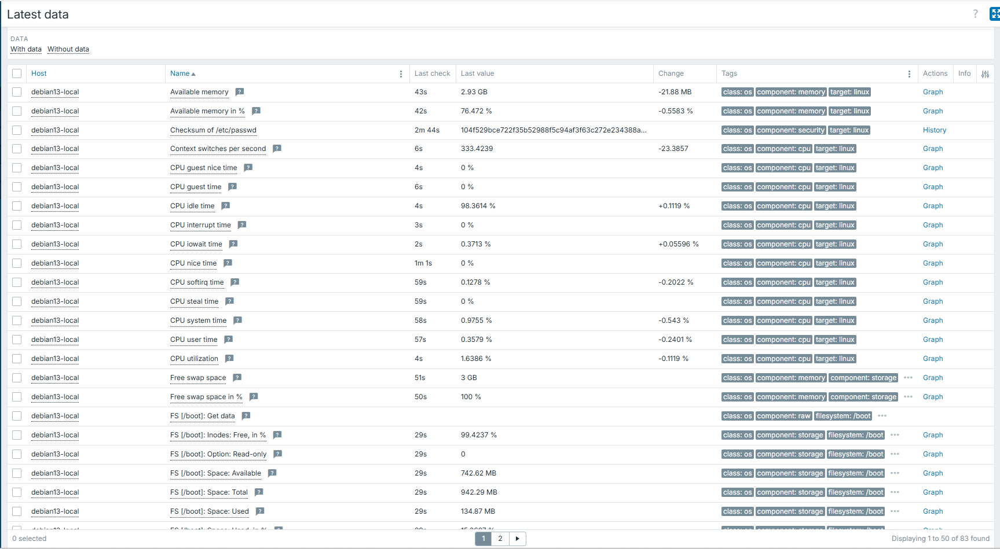
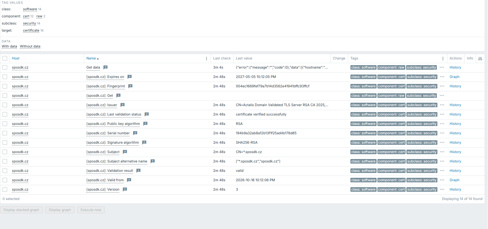
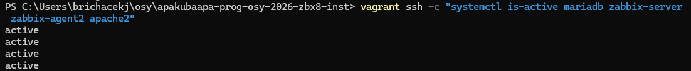

# Instalace Zabbixu 8.0 LTS (Vagrant + Debian 13 + MariaDB)


Reprodukovatelná instalace **Zabbix serveru 8.0 LTS** ve virtuálním stroji **Debian 13** pomocí **Vagrantu** a shell skriptů. Databází je **MariaDB**, webový server **Apache**. Na stejném stroji běží i **Zabbix Agent 2**, který monitoruje místní server. Celá instalace se provede jedním příkazem `vagrant up`, uvnitř VM se nic neinstaluje ručně.

## Předpoklady

- VirtualBox a Vagrant na hostitelském počítači,
- volný port `8080` na `127.0.0.1`,
- připojení k internetu (stahuje se box `bento/debian-13` a balíčky z oficiálního repozitáře Zabbix 8.0),
- dostatek paměti pro VM (2 CPU a 2 GB RAM je minimum podle zadání),
- první `vagrant up` trvá několik minut (stahují se stovky balíčků PHP a Zabbixu).

## Spuštění

```powershell
vagrant up              # vytvoří VM a provede kompletní instalaci
vagrant ssh             # přihlášení do VM
vagrant provision       # opakované spuštění skriptů (databázi nemaže)
vagrant halt            # vypnutí VM
vagrant destroy -f      # smazání VM
```

Před odevzdáním je dobré ověřit celý postup z čistého stavu: `vagrant destroy -f` a znovu `vagrant up`.

## Obsah repozitáře

| Soubor | Účel |
| --- | --- |
| `Vagrantfile` | box `bento/debian-13`, VirtualBox, přesměrování portů jen na `127.0.0.1` (HTTP `8080`, SSH `2209`), spuštění obou skriptů |
| `install-zabbix8.sh` | přidá oficiální repozitář Zabbix 8.0, nainstaluje MariaDB, Zabbix server, webové rozhraní, Apache, SQL skripty a Agent 2, ověří verzi 8.0 |
| `configure-zabbix8.sh` | vytvoří databázi a uživatele, jednorázově naimportuje schéma, nastaví server, web (`zabbix.conf.php`) a agenta, spustí služby a přes Zabbix API přidá hosty |
| `export/` | kopie exportu hosta `sposdk.cz` (pokud je k dispozici) |
| `Images/` | snímky obrazovky |

Oba skripty používají `set -euo pipefail`, takže při jakékoli chybě končí nenulovým návratovým kódem a Vagrant provisioning přeruší.

## Co skripty dělají

**`install-zabbix8.sh`**

1. Stáhne oficiální repozitářový balíček Zabbix 8.0 pro Debian 13 (`zabbix-release_latest_8.0+debian13_all.deb`) a přidá repozitář. Balíčky Zabbixu z výchozího repozitáře Debianu se nepoužívají.
2. Nainstaluje `mariadb-server`, `zabbix-server-mysql`, `zabbix-frontend-php`, `zabbix-apache-conf`, `zabbix-sql-scripts` a `zabbix-agent2`.
3. Zkontroluje, že nainstalovaná verze Zabbix serveru je opravdu 8.0.

**`configure-zabbix8.sh`**

1. Vytvoří databázi `zabbix` s kódováním `utf8mb4` a uživatele `zabbix` s právy jen na tuto databázi.
2. Počáteční schéma a data naimportuje **právě jednou**. Pokud už v databázi existuje tabulka `users`, import se přeskočí, takže `vagrant provision` data nesmaže.
3. Nastaví připojení Zabbix serveru k databázi (`/etc/zabbix/zabbix_server.conf`).
4. Vytvoří `/etc/zabbix/web/zabbix.conf.php`, takže se nemusí procházet instalační průvodce v prohlížeči. V něm je i **název serveru zobrazený v záhlaví webu**.
5. Nastaví Agent 2 (`Server=127.0.0.1`, `Hostname=debian13-local`), spustí a povolí služby `mariadb`, `zabbix-server`, `zabbix-agent2` a `apache2`.
6. Přes Zabbix API přidá hosty (viz sekce Monitorování) a nakonec ověří, že všechny služby běží.

## Web

- **http://127.0.0.1:8080/zabbix/** (kořen `http://127.0.0.1:8080/` přesměruje na `/zabbix/`)
- uživatel `Admin`, výchozí heslo Zabbixu (skripty ho nemění; v ostrém nasazení by se mělo po prvním přihlášení změnit).

Název serveru v záhlaví je vlastní: **„Zabbix 8 - brichacek“**. Je nastaven ve skriptu `configure-zabbix8.sh` (proměnná `SERVER_NAME`) a promítá se do `$ZBX_SERVER_NAME` v `zabbix.conf.php`.



## Hesla

V repozitáři, README ani na snímcích obrazovky není žádné heslo.

- **Heslo k databázi** (uživatel `zabbix`) se při prvním spuštění **náhodně vygeneruje** přímo ve VM a uloží do souboru `/root/zabbix-secrets.env` s právy 600 (čte ho jen root). Zobrazí se příkazem:

  ```powershell
  vagrant ssh -c "sudo cat /root/zabbix-secrets.env"
  ```

  Při opakovaném `vagrant provision` se stejné heslo znovu použije. Heslo se do databáze předává přes standardní vstup, takže není vidět v seznamu procesů.
- Skript lze také spustit s vlastním heslem, pokud `Vagrantfile` předá proměnnou `ZBX_DB_PASSWORD` do provisioneru (`env: { "ZBX_DB_PASSWORD" => ENV["ZBX_DB_PASSWORD"] }`). Povolené jsou jen znaky `A-Za-z0-9`.
- Heslo webového uživatele `Admin` zůstává výchozí, aby se mohl snadno přihlásit každý, kdo projekt spustí.

## Monitorování

- **Lokální host `debian13-local`**: přidán přes API, rozhraní agenta `127.0.0.1:10050`, šablona *Linux by Zabbix agent* (funguje s Agentem 2). Hostname v konfiguraci agenta je stejný jako název hosta. Zabbix také sám vytváří výchozí host `Zabbix server`, který je monitorován stejným agentem.
- **Host `sposdk.cz`** (TLS/SSL certifikát `https://sposdk.cz`): skript se nejdřív pokusí importovat export hosta ze složky `Zabbix/export` (případně `export/`). V mém projektu se export nepodařilo najít, proto skript vytvořil host přes API se šablonou **Website certificate by Zabbix agent 2** a makrem `{$CERT.WEBSITE.HOSTNAME}=sposdk.cz`. Šablona používá klíč `web.certificate.get` Agenta 2, který kontroluje certifikát přímo z VM.

## Ověření

1. Otevřít `http://127.0.0.1:8080/zabbix/` a ověřit název serveru v záhlaví.
2. **Monitoring → Latest data**, filtr Hosts: `debian13-local`. Jsou vidět aktuální hodnoty z agenta.

   

3. **Monitoring → Latest data**, filtr Hosts: `sposdk.cz`. Jsou vidět údaje o certifikátu: platnost od 2026-10-18 do 2027-05-05, vydavatel Actalis, subjekt `*.sposdk.cz`, stav ověření `certificate verified successfully`.

   

4. Ověření běhu služeb:

   ```powershell
   vagrant ssh -c "systemctl is-active mariadb zabbix-server zabbix-agent2 apache2"
   ```

   Výstup je čtyřikrát `active`.

   

## Řešení potíží

- **Přihlášení do API selhalo (`Nelze se prihlasit do Zabbix API`)**: v první verzi skriptu se do API předávalo prázdné heslo, protože se proměnná s heslem nepředávala podprocesu `jq`. Opraveno předáním hesla přes `jq --arg`.
- **`The SSH connection was unexpectedly closed by the remote end` po „Setting hostname“ nebo `Timed out while waiting for the machine to boot`**: potíž VirtualBoxu při startu VM, skripty se ještě nespustily. Pomohlo smazat nedokončenou VM (`vagrant destroy -f`, případně ji odstranit ve VirtualBox Manageru), restartovat počítač a spustit `vagrant up` znovu. Případně lze zvýšit `config.vm.boot_timeout`.
- **Nelze stáhnout repozitářový balíček Zabbix**: skript zkouší oba názvy `zabbix-release_latest_8.0+debian13_all.deb` a `zabbix-release_latest+debian13_all.deb`. Aktuální název je na <https://www.zabbix.com/download>.
- **Kontrola verze balíčku selhala**: balíčky Zabbixu 8.0 mají verzi s epochou `2:8.0.0-...`, ne `1:`. Kontrola ve skriptu s tím počítá.
- **Export hosta `sposdk.cz` nenalezen**: skript vypíše, kde hledal, a použije záložní vytvoření hosta přes API. Import se provede jen tehdy, když host ještě neexistuje, proto je před novým pokusem nutný čistý běh (`vagrant destroy -f` a `vagrant up`).
- **Port 8080 je obsazený**: změňte `host:` u `forwarded_port` ve `Vagrantfile`.
- **Skripty na Windows nejdou spustit (`\r` na konci řádků)**: pomáhá `.gitattributes` s `eol=lf` pro `*.sh`.
- **Stránka zabbix po startu hned neodpovídá**: služby potřebují po restartu několik sekund, skript proto čeká na odpověď webu až 2 minuty.
